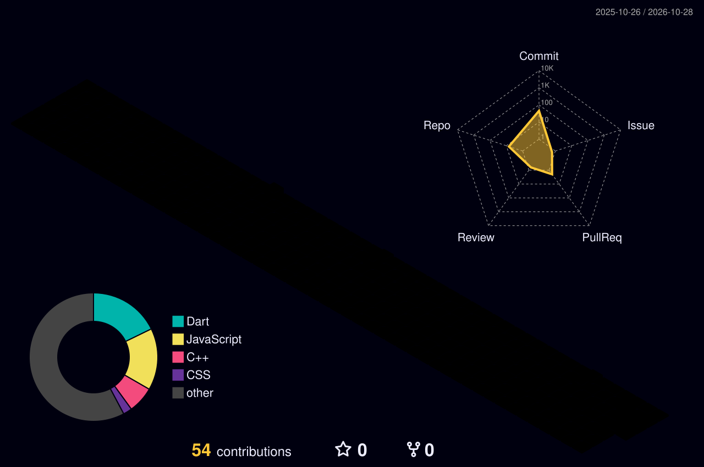

# 👨‍💻 Rahul Rajput

### Flutter Developer | Mobile App Engineer

 

Building scalable mobile applications with Flutter and Dart.

---

## 🧑‍🚀 About Me

- 📱 Flutter Developer specializing in cross-platform applications.
- 🎯 Focused on clean architecture and maintainable code.
- ⚡ Experienced with Riverpod, Provider, REST APIs and Firebase.
- 🌱 Exploring React, JavaScript and modern web development.
- 🚀 Building products that solve real-world problems.

---

## 🛠️ Tech Stack

---

## 📊 GitHub Statistics

 

---

## 📈 My 3D GitHub Contributions

  

---

## 🚀 Featured Projects

### 📱 Flutter Data Structures
Interactive Flutter application demonstrating data structures.

[View Repository →](https://github.com/RahuL-XYZ/flutter-ds-app)

### 🚗 Car Dodging Game
A game project built with Dart.

[View Repository →](https://github.com/RahuL-XYZ/Car-Dodging-Game)

### 📋 Taskora
A project exploring web development and task management.

[View Repository →](https://github.com/RahuL-XYZ/taskora)

### 💰 Kharcha Paani
An expense-management project.

[View Repository →](https://github.com/RahuL-XYZ/Kharcha-Paani-Admin)

### 🌐 Developer Portfolio
My personal portfolio project.

[View Repository →](https://github.com/RahuL-XYZ/rahul-rajput-portfolio)

---

## 🌐 Connect With Me

<!-- Add your LinkedIn and portfolio links here. -->

---

### 💙 Thanks for visiting my profile!

*Building. Learning. Improving. Repeating.*

