 

## The suit

I build cross-platform mobile apps with Flutter. I care about code that stays readable six months later: feature-first folders, a clear domain layer, and state that is easy to trace.

| | |
|---|---|
| **Main focus** | Cross-platform mobile apps |
| **Architecture** | Clean Architecture, MVVM |
| **State** | Riverpod, Provider, GetX |
| **Backend** | Firebase, REST APIs |
| **Exploring** | React, JavaScript, Three.js |

 

## Web-shooter stats

<b>Contribution graph</b>

 

## Featured missions

## Currently

- Shipping Flutter apps with Riverpod and Clean Architecture
- Learning React and JavaScript properly, not just following tutorials
- Experimenting with Three.js for 3D on the web

 

